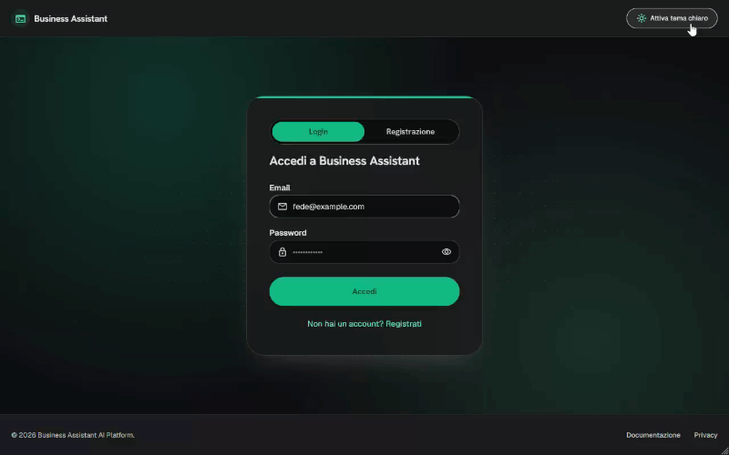
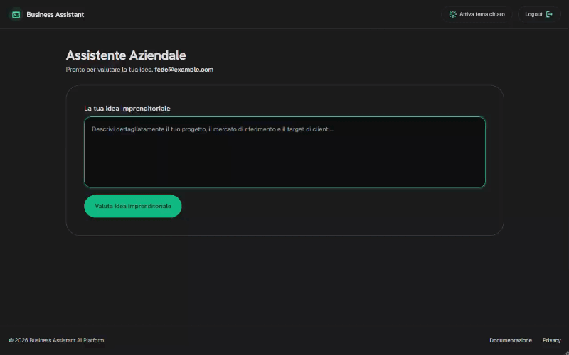

# Business Assistant

Business Assistant è un'applicazione web che valuta un'idea imprenditoriale con l'Intelligenza Artificiale. Dopo l'accesso, l'utente descrive la propria idea e riceve un Business Success Score, 8 metriche, l'analisi SWOT, i principali competitor, un esito GO / NO GO e 3 suggerimenti operativi. Il report si può scaricare in PDF.

L'applicazione è composta da:

- **Frontend**: React + Vite
- **Autenticazione**: Supabase Auth (email e password)
- **Backend**: una Supabase Edge Function (`evaluate-idea`) che interroga un modello AI compatibile con le API di OpenAI (per esempio Groq o OpenAI)

Questa guida spiega come installare il progetto, configurarlo e avviarlo sul proprio computer.

## Anteprima

### Accesso

L'utente accede con email e password oppure crea un nuovo account. Dal pulsante in alto a destra si passa dal tema scuro al tema chiaro.



### Dashboard

Dopo l'accesso, l'utente descrive la propria idea imprenditoriale e avvia la valutazione.



---

## 1. Prerequisiti

Prima di iniziare servono:

| Requisito                                             | Note                                                                               |
| ----------------------------------------------------- | ---------------------------------------------------------------------------------- |
| **Node.js** 20.19 o superiore (consigliata la 22 LTS) | Scaricabile da [nodejs.org](https://nodejs.org). Include anche `npm`.              |
| **Git**                                               | Serve per scaricare il repository.                                                 |
| **Account Supabase**                                  | Gratuito, su [supabase.com](https://supabase.com).                                 |
| **Chiave API di un provider AI**                      | Per esempio [Groq](https://console.groq.com) (ha un piano gratuito) oppure OpenAI. |

La CLI di Supabase non va installata a parte: è già tra le dipendenze del progetto e si usa con `npx supabase`.

Per controllare la versione di Node.js installata:

```bash
node -v
```

---

## 2. Installazione

Apri un terminale nella cartella in cui vuoi salvare il progetto ed esegui:

```bash
# 1. Scarica il repository (sostituisci con l'indirizzo del tuo repository)
git clone <URL-del-repository>

# 2. Entra nella cartella del progetto
cd business-assistant

# 3. Installa le dipendenze
npm install
```

---

## 3. Configurazione di Supabase

### 3.1 Creare il progetto

1. Accedi a [Supabase](https://supabase.com/dashboard).
2. Crea un nuovo progetto (**New Project**), scegli un nome (per esempio `BusinessAssistant`) e imposta una password per il database.
3. Quando il progetto è pronto, copia il **Project ID** (detto anche _Project Ref_). Lo trovi in **Project Settings → General**.

L'applicazione non usa tabelle proprie: non serve creare tabelle né eseguire migrazioni.

### 3.2 Collegare il progetto locale

```bash
# 1. Accedi a Supabase dal terminale (si apre una finestra del browser)
npx supabase login

# 2. Collega la cartella locale al progetto remoto
npx supabase link --project-ref <il-tuo-project-id>
```

### 3.3 Configurare l'autenticazione

La registrazione avviene con email e password, e Supabase invia un'email di conferma. Perché il link nell'email riporti all'applicazione:

1. Vai su **Authentication → URL Configuration**.
2. In **Site URL** inserisci l'indirizzo dell'applicazione. In locale è `http://localhost:5173`.
3. Se l'app verrà pubblicata online, aggiungi anche l'indirizzo pubblico in **Redirect URLs**.

Il provider **Email** è attivo di default in **Authentication → Sign In / Providers**.

---

## 4. Variabili d'ambiente

### 4.1 Frontend (file `.env`)

Nella cartella principale del progetto crea un file chiamato esattamente `.env` con queste variabili:

```env
VITE_SUPABASE_URL=
VITE_SUPABASE_ANON_KEY=
```

| Variabile                | Dove si trova                                                |
| ------------------------ | ------------------------------------------------------------ |
| `VITE_SUPABASE_URL`      | Supabase → **Project Settings → API** → _Project URL_        |
| `VITE_SUPABASE_ANON_KEY` | Supabase → **Project Settings → API** → chiave _anon public_ |

Il file `.env` è già escluso da Git e non va mai pubblicato nel repository.

### 4.2 Edge Function (secrets di Supabase)

La chiave del provider AI non deve mai stare nel frontend: viene salvata come _secret_ su Supabase e la legge solo la Edge Function.

| Secret        | Obbligatorio | Descrizione                                                           |
| ------------- | ------------ | --------------------------------------------------------------------- |
| `AI_API_KEY`  | Sì           | Chiave API del provider AI                                            |
| `AI_BASE_URL` | No           | Indirizzo dell'API del provider. Default: `https://api.openai.com/v1` |
| `AI_MODEL`    | No           | Modello da usare. Default: `gpt-4o-mini`                              |

Esempio di configurazione con **Groq**:

1. Su [Groq Console](https://console.groq.com) vai in **API Keys** e crea una nuova chiave (inizia con `gsk_`).
2. Salva i secrets su Supabase:

```bash
npx supabase secrets set AI_API_KEY=<la-tua-chiave>
npx supabase secrets set AI_BASE_URL=https://api.groq.com/openai/v1
npx supabase secrets set AI_MODEL=openai/gpt-oss-120b
```

3. Verifica che siano stati salvati:

```bash
npx supabase secrets list
```

Se usi OpenAI basta impostare `AI_API_KEY`: indirizzo e modello hanno già i valori predefiniti.

---

## 5. Deploy della Edge Function

Pubblica la funzione `evaluate-idea` sul tuo progetto Supabase:

```bash
npx supabase functions deploy evaluate-idea --no-verify-jwt
```

Al termine la funzione è attiva e l'applicazione la richiama automaticamente. Va ripubblicata ogni volta che modifichi il file `supabase/functions/evaluate-idea/index.js`.

I secrets si possono modificare in qualsiasi momento senza ripubblicare la funzione.

---

## 6. Avvio in locale

```bash
npm run dev
```

1. Apri nel browser l'indirizzo indicato da Vite (di solito `http://localhost:5173`).
2. Clicca su **"Non hai un account? Registrati"** e crea un account.
3. Accedi con email e password.
4. Nella Dashboard descrivi la tua idea (almeno 30 caratteri) e avvia l'analisi.
5. Al termine puoi scaricare il report in PDF.

---

## Comandi disponibili

| Comando           | Cosa fa                                             |
| ----------------- | --------------------------------------------------- |
| `npm run dev`     | Avvia l'applicazione in sviluppo                    |
| `npm run build`   | Crea la versione ottimizzata nella cartella `dist/` |
| `npm run preview` | Mostra in locale la versione creata con `build`     |
| `npm run lint`    | Controlla il codice con oxlint                      |
